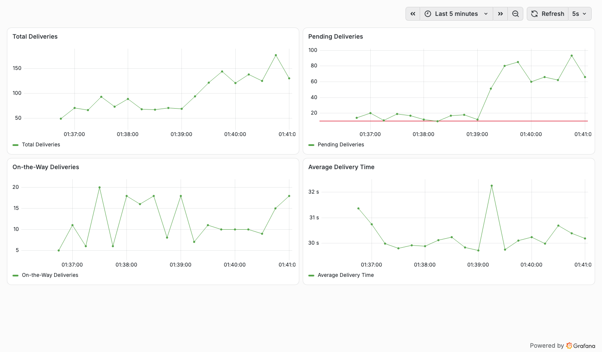
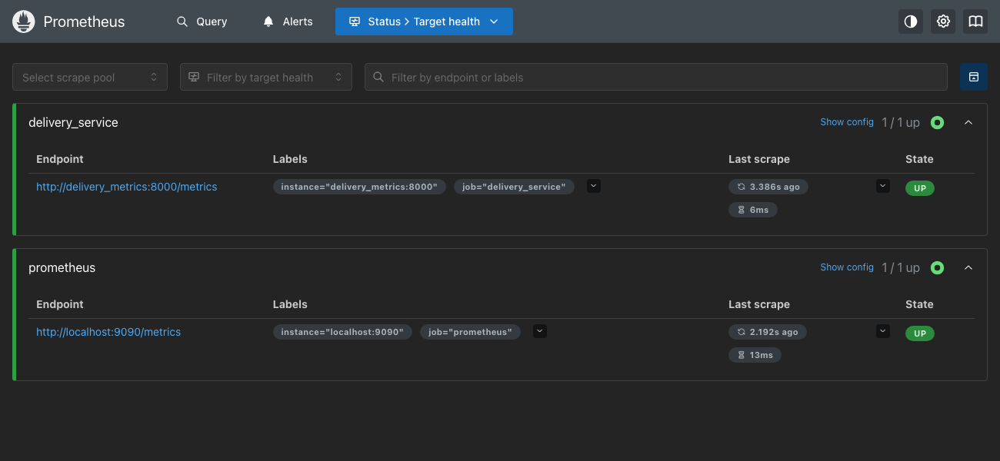
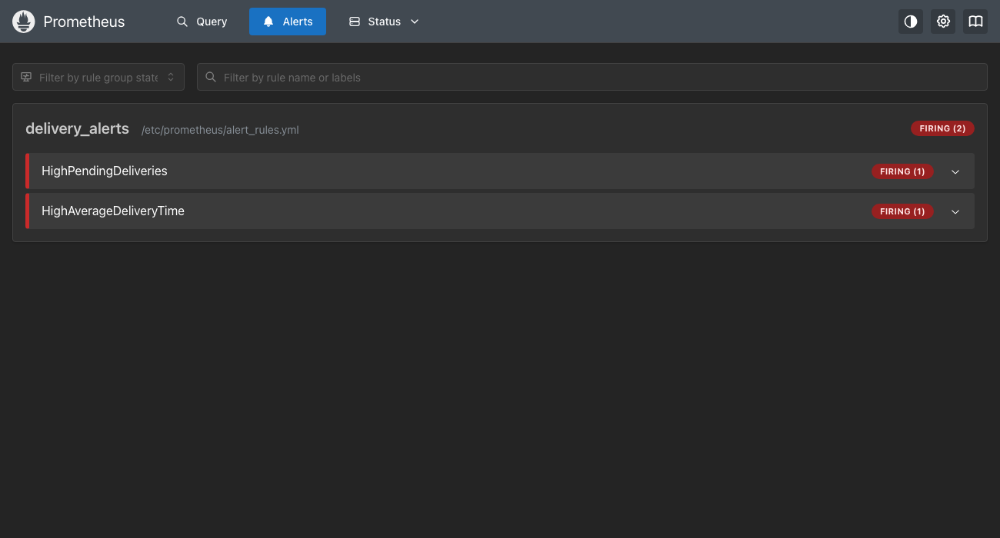

# Exercise 6: Real-Time Operations Monitoring and Alerting (Prometheus + Grafana + Jenkins)

Source exercise: [DevOps-Lab/Exercises/6-Grafana-Realtime-Monitoring-of-Quick-Commerce-App.md](https://github.com/SunagP/DevOps-Lab/blob/main/Exercises/6-Grafana-Realtime-Monitoring-of-Quick-Commerce-App.md)

A Jenkins pipeline builds and starts three containers. The first is a Python app that simulates
ZAPPTTO delivery metrics. The second is Prometheus, which scrapes the app and evaluates alert
rules. The third is Grafana, with a 4-panel dashboard.



## Files
| File | Purpose |
|---|---|
| [`delivery_metrics.py`](./delivery_metrics.py) | Exposes `total_deliveries`, `pending_deliveries`, `on_the_way_deliveries` (Gauges) and `average_delivery_time` (Summary) on `:8000/metrics`. The pending range can be overridden with `PENDING_MIN`/`PENDING_MAX` env vars, which Step 6 uses instead of editing the code. |
| [`Dockerfile`](./Dockerfile) | Image for the app. The source exercise builds `delivery_metrics` in its Jenkinsfile but never provides a Dockerfile. |
| [`prometheus.yml`](./prometheus.yml) | Scrapes itself and `delivery_metrics:8000` every 5s and loads `alert_rules.yml`. |
| [`alert_rules.yml`](./alert_rules.yml) | `HighPendingDeliveries` (`pending_deliveries > 10` for 15s, warning) and `HighAverageDeliveryTime` (avg > 30s, critical). Same as the source. |
| [`grafana/provisioning/`](./grafana/provisioning) | Provisions the Prometheus data source and the **Delivery Monitoring** dashboard with the 4 panels the exercise asks for. |
| [`Jenkinsfile`](./Jenkinsfile) | Pipeline: Pre-check Docker → Setup Workspace → Cleanup Previous Run → Build Docker Image → Run Application → Run Prometheus & Grafana → Verify. |
| [`jenkins/Dockerfile`](./jenkins/Dockerfile) | `jenkins/jenkins:lts` plus the Docker CLI, so pipeline `sh 'docker …'` steps work. |

## Changes vs. the source exercise (all needed to make it run on macOS / Docker Desktop)
- **No `172.17.0.1` or `--network=host`.** The source's targets and data source URLs use the
  Linux `docker0` IP, which doesn't exist on Docker Desktop. All three containers instead join a
  user-defined network, `delivery-net`, and reach each other by name: Prometheus scrapes
  `delivery_metrics:8000`, and Grafana uses `http://prometheus:9090`.
- **Jenkins can run Docker.** The stock Jenkins image has no `docker` binary, so the source's
  "Pre-check Docker" stage would fail. `jenkins/Dockerfile` adds the CLI, and the container gets
  the host socket (`-v /var/run/docker.sock`, `--group-add 0`).
- **Config files go in with `docker cp`, not `-v $WORKSPACE/...`.** `$WORKSPACE` is a path
  inside the Jenkins container, so the host daemon can't bind-mount it. The pipeline runs
  `docker create`, then `docker cp` for the configs, then `docker start`.
- **Setup Workspace copies from a mounted folder.** The source's `localSourcePath` placeholder
  points at this exercise folder, mounted read-only into Jenkins at `/delivery_monitoring`.
- **Grafana is configured from files.** The data source and dashboard are provisioned instead of
  clicked together in the UI. Anonymous **Viewer** access is enabled so the dashboard can be
  screenshotted. Admin login is still `admin`/`admin`.
- Added a **Cleanup** stage so the pipeline can be re-run, and a **Verify** stage.
- `scrape_interval` and `evaluation_interval` are set to 5s (default 15s) so the `for: 15s`
  alert reacts quickly.

## What was done
```bash
# Jenkins with Docker access (reuses the jenkins_home volume from Exercise 7)
docker build -t jenkins-docker jenkins/
docker run -d --name jenkins -p 8080:8080 -p 50000:50000 \
  -v jenkins_home:/var/jenkins_home \
  -v /var/run/docker.sock:/var/run/docker.sock --group-add 0 \
  -v "$PWD":/delivery_monitoring:ro jenkins-docker

# New Item > Pipeline "delivery-monitoring" > Pipeline script = Jenkinsfile, then Build Now
# (done with the Jenkins CLI: create-job + build -s -v)

# Step 6: simulate alerts
docker rm -f delivery_metrics
docker run -d -p 8000:8000 --name delivery_metrics --network delivery-net \
  -e PENDING_MIN=50 -e PENDING_MAX=100 delivery_metrics
```

## Results
1. **Jenkins pipeline:** `delivery-monitoring #1` finished **SUCCESS**, and all 7 stages ran.
   The Verify stage showed live metrics, `Prometheus Server is Ready.` and Grafana health
   `"database": "ok"` (v13.2.4).
2. **Prometheus targets:** both `delivery_service` (`http://delivery_metrics:8000/metrics`) and
   `prometheus` are **UP**.
   
3. **Queries:** `total_deliveries`, `pending_deliveries`, `on_the_way_deliveries` and
   `average_delivery_time_sum / average_delivery_time_count` all return data. The average hovers
   around 30s, as expected for `uniform(15, 45)`.
4. **Grafana:** the provisioned **Prometheus** data source passes its health check ("Successfully
   queried the Prometheus API"). The **Delivery Monitoring** dashboard has the 4 required panels.
   The Pending panel draws the alert threshold (10) as a red line.
5. **Alerts:**
   - With the default range (10–20), `HighPendingDeliveries` was **already firing**. Since
     `pending > 10` is true 10 times out of 11, the source's "ensure values exceed the threshold"
     comment holds.
   - **Step 6:** raising pending to 50–100 pushed it to 62–95 (visible as the jump in the
     dashboard), and `HighPendingDeliveries` kept firing.
   - `HighAverageDeliveryTime` (critical) also fired after the restart. The app restart reset the
     Summary's running `_sum/_count`, so the first samples swung above 30s.
   - This rule has no `for:`, so it flaps around the 30s mean rather than meaning "for the last
     15 seconds" as its description says.
   

Full transcript (pipeline console, API checks): [run-output.log](./run-output.log)

## Cleanup
```bash
docker rm -f delivery_metrics prometheus grafana
docker network rm delivery-net
```
